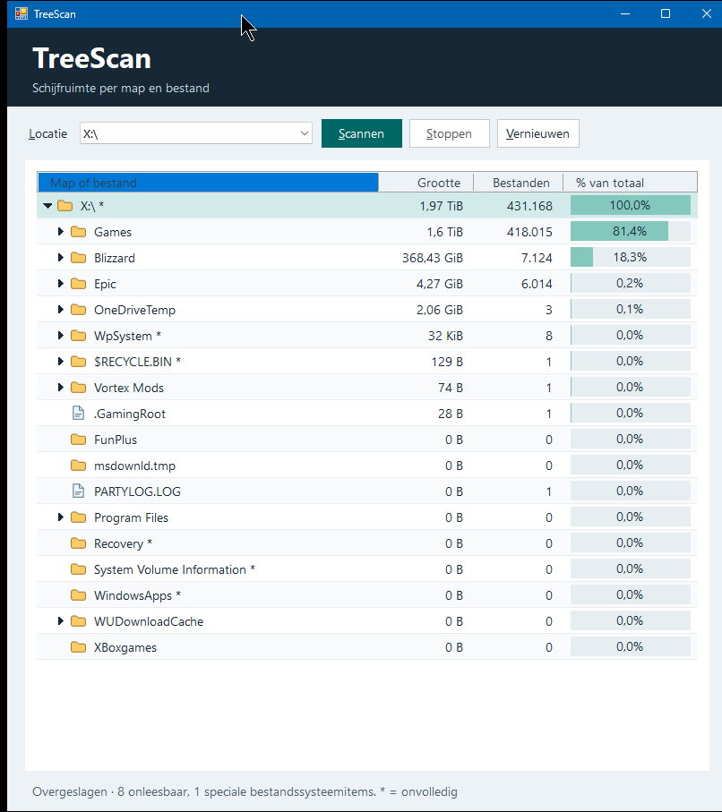

# TreeScan

TreeScan is a Windows app written in C# that shows which folders and files take up the most disk space.

**Supervised AI project.** TreeScan was built with Codex under human supervision.

- Explore an expandable tree with the largest items first.
- See the size, file count, and share of the total scan in each row.
- Open a folder or locate a file in Windows File Explorer from TreeScan.



*Screenshot from version 1.0.0, which used the Dutch interface.*

## Install and use

1. Download and run the Windows x64 installer (`.msi`) from this project's releases. It installs TreeScan for your Windows account and automatically upgrades an earlier MSI installation for that account.
2. Right-click a drive or folder in File Explorer and choose **Scan with TreeScan**. On Windows 11, look under **Show more options**.
3. You can also launch TreeScan from the Start menu and select a drive.

TreeScan requires x64 Windows with .NET Framework 4.8 or later. An asterisk (`*`) in the tree marks an incomplete total. TreeScan may skip locations it cannot read and file system links.

To uninstall TreeScan and remove its File Explorer menu entries, go to **Settings → Apps → Installed apps**.

## Build from source

Use PowerShell on Windows with the .NET 9 SDK and the .NET Framework 4.8 Developer Pack.

```powershell
dotnet build -c Release
./installer/Build-Msi.ps1
```

The executable is in `bin/Release/net48/`. The installer build script uses WiX 6.0.2 and writes the MSI to `bin/installer/`.
